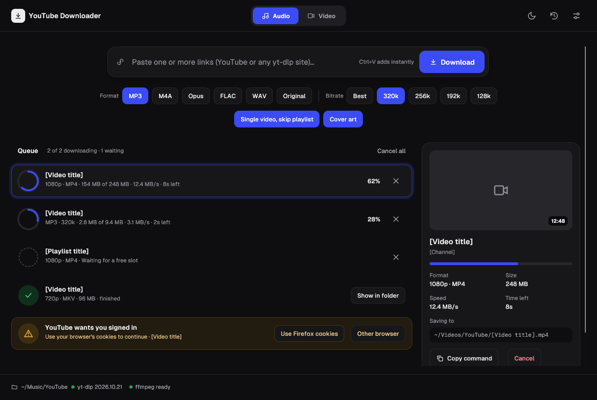
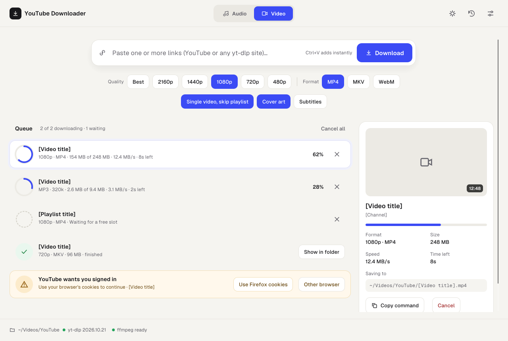
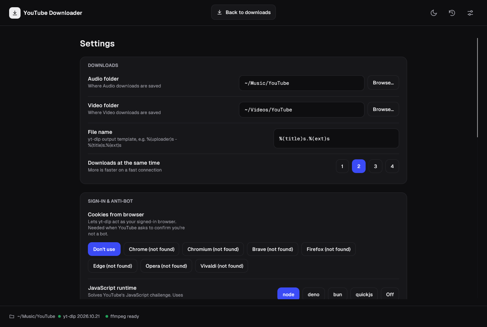
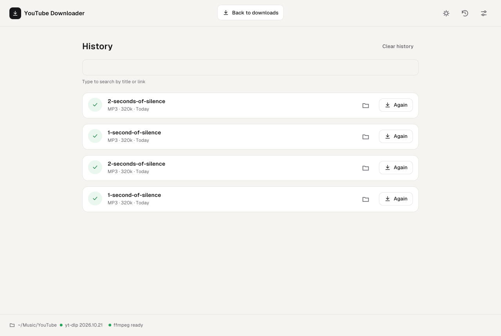

# YouTube Downloader

[](https://github.com/genetzhs/Youtube-downloader/actions/workflows/ci.yml)


A fast, native desktop app for downloading audio and video with
[yt-dlp](https://github.com/yt-dlp/yt-dlp). Written in Rust with
[egui](https://github.com/emilk/egui). It replaces the earlier Python app,
[genetzhs/youtubeDL](https://github.com/genetzhs/youtubeDL).

| Dark | Light |
|---|---|
|  |  |
|  |  |

> The main window screenshots use sample queue items (`--demo`) to show every state at once.

## Features

- **Audio or video, one click.** Audio as MP3, M4A, Opus, FLAC, WAV or Vorbis (64–320 kbps or
  best). Video up to 2160p as MP4, MKV or WebM.
- **Paste many links at once.** Every link gets its own card with title, thumbnail, progress,
  speed and time left. Two downloads run at the same time and the rest wait their turn.
- **Playlists**, or just the single video with *skip playlist*.
- **Cover art and tags.** Embeds the thumbnail as album art and writes title, artist and other
  metadata. Subtitles and an info JSON are optional.
- **Handles "Sign in to confirm you're not a bot".** One click retries with the cookies from your
  browser (Chrome, Chromium, Brave, Firefox, Edge, Opera, Vivaldi or Safari).
- **Nothing else to install.** yt-dlp, ffmpeg and ffprobe ship inside the package, and yt-dlp
  updates itself (checksum-verified) because YouTube changes often.
- **Shows the exact command** it runs, with a copy button, and a log for every download.
- **History** of finished downloads, and a desktop notification when the queue is done.
- **Dark and light themes**, or follow the system setting. Switch with the sun/moon button
  in the top right.

## Install

Download the file for your system from the
[Releases](https://github.com/genetzhs/Youtube-downloader/releases) page. Everything the app
needs (yt-dlp, ffmpeg, ffprobe) is inside; nothing else to install.

| System | File |
|---|---|
| Ubuntu, Debian, Linux Mint, Pop!_OS (Ubuntu 22.04 / Debian 12 or newer) | `youtube-downloader_<version>_amd64.deb` |
| Any other Linux (x86_64) | `YouTube_Downloader-<version>-x86_64.AppImage` |
| Mac with Apple Silicon (M1 and newer) | `YouTube_Downloader-<version>-macos-arm64.dmg` |
| Mac with Intel | `YouTube_Downloader-<version>-macos-x86_64.dmg` |

Each release also lists `SHA256SUMS` to check the downloads.

### Linux: .deb

```bash
sudo apt install ./youtube-downloader_<version>_amd64.deb
```

Open **YouTube Downloader** from the applications menu, or run `youtube-downloader`.
To remove it: `sudo apt remove youtube-downloader`.

### Linux: AppImage

```bash
chmod +x YouTube_Downloader-<version>-x86_64.AppImage
./YouTube_Downloader-<version>-x86_64.AppImage
```

If it does not start, your system may be missing FUSE 2: install `libfuse2`
(on Ubuntu 24.04 and newer: `sudo apt install libfuse2t64`), or run it with
`--appimage-extract-and-run`.

### macOS

1. Open the `.dmg` and drag **YouTube Downloader** onto **Applications**.
2. The first time, macOS says the app "cannot be opened" because it is not notarized by
   Apple. Open **System Settings → Privacy & Security**, scroll down and click **Open Anyway**.
   Or run:

   ```bash
   xattr -dr com.apple.quarantine "/Applications/YouTube Downloader.app"
   ```

## Using it

1. Copy a link from YouTube (or any [site yt-dlp supports](https://github.com/yt-dlp/yt-dlp/blob/master/supportedsites.md)).
2. Choose **Audio** or **Video** at the top, then the format and quality.
3. Press <kbd>Ctrl</kbd>/<kbd>⌘</kbd>+<kbd>V</kbd> anywhere in the window: the links start
   downloading right away. Or type in the field and press **Download**. Paste several links at
   once to queue them all.
4. When a card shows a check mark, click **Show in folder**. Click any card to see its details,
   copy the exact yt-dlp command, or open its log.

Finished downloads are listed under **History** (clock icon), where you can search them and
download one again. **Settings** (sliders icon) has the folders, file name template, how many
downloads run at once, browser cookies, yt-dlp updates and the theme.

Files go to `~/Music/YouTube` for audio and `~/Videos/YouTube` (Linux) or `~/Movies/YouTube`
(macOS) for video. Change this in **Settings**.

## Troubleshooting

**"YouTube wants you signed in" / "confirm you're not a bot"**
: Sign in to YouTube in one of your browsers, then click **Use … cookies** on the card (or set
  *Cookies from browser* in Settings) and retry.

**Safari cookies on macOS**
: macOS protects Safari's cookies. Give the app *Full Disk Access* in
  **System Settings → Privacy & Security**, or use another browser's cookies.

**Chrome/Brave/Edge cookies on Linux**
: These browsers encrypt cookies with your desktop keyring (GNOME Keyring or KWallet). Make sure
  you are logged in to a desktop session with the keyring unlocked.

**A site stopped working**
: Sites change and yt-dlp follows quickly. The app updates yt-dlp on its own; you can also click
  **Check for update** in Settings.

**Something else**
: Click **Show log** on the download and include the log when you
  [open an issue](https://github.com/genetzhs/Youtube-downloader/issues).

## Where settings are stored

| | Linux | macOS |
|---|---|---|
| Settings | `~/.config/youtube-downloader/config.toml` | `~/Library/Application Support/youtube-downloader/config.toml` |
| History | `~/.local/share/youtube-downloader/history.json` | `~/Library/Application Support/youtube-downloader/history.json` |
| Updated yt-dlp | `~/.local/share/youtube-downloader/bin/yt-dlp` | `~/Library/Application Support/youtube-downloader/bin/yt-dlp` |

Deleting these folders resets the app.

## Status

| | Milestone | State |
|---|---|---|
| M1 | `ytdl-core`: command builder, progress parser, queue, settings, history, tool lookup | ✅ done |
| M2 | `ytdl-runner`: run yt-dlp, live progress, cancel, two at a time, yt-dlp self-update | ✅ done |
| M3 | Window, dark and light themes, custom widgets | ✅ done |
| M4 | Real downloads from the window: queue, thumbnails, details, log, cookie retry | ✅ done |
| M5 | Settings, history, notifications | ✅ done |
| M6 | Packages: `.deb`, AppImage, macOS `.dmg`, release workflow | ✅ done |

## Build from source

You need [Rust](https://rustup.rs) 1.88 or newer. On Linux the window also needs
`libxkbcommon-x11-0`, which desktop systems normally have already.

```bash
git clone https://github.com/genetzhs/Youtube-downloader.git
cd Youtube-downloader
cargo test
```

Run the app. When built from source it uses `yt-dlp` and `ffmpeg` from your `PATH` (or
downloads yt-dlp itself on first start):

```bash
cargo run -p youtube-downloader
cargo run -p youtube-downloader -- "https://www.youtube.com/watch?v=<id>"   # queue links at start
cargo run -p youtube-downloader -- --demo --theme light                      # sample queue, light theme
```

The download engine also has a terminal example:

```bash
cargo run -p ytdl-runner --example cli -- "https://www.youtube.com/watch?v=<id>" --out ~/Downloads
# add --update to download the latest yt-dlp into a temporary folder first
```

### Project layout

```
crates/
  app/           The egui window: theme, widgets, pages (Downloads, History,
                 Settings). Builds the `youtube-downloader` binary.
  ytdl-core/     Logic with no UI: yt-dlp arguments, output parsing, queue,
                 settings, history, finding tools. Fully unit tested.
  ytdl-runner/   Runs yt-dlp processes for the queue and updates yt-dlp.
assets/          App icons
packaging/       Scripts and files for .deb, AppImage and macOS packages
docs/            Screenshots
```

### Checks

```bash
cargo fmt --all --check
cargo clippy --all-targets -- -D warnings
cargo test
cargo test -p ytdl-runner -- --ignored   # also downloads the real yt-dlp from GitHub
```

### Packages

```bash
packaging/fetch-tools.sh linux-x64 packaging/build/linux-x64   # yt-dlp + ffmpeg, checksum-verified
cargo build --release -p youtube-downloader
cargo deb -p youtube-downloader --no-build                       # needs `cargo install cargo-deb`
packaging/linux/build-appimage.sh target/release/youtube-downloader packaging/build/linux-x64 out.AppImage
# on a Mac:
packaging/macos/build-app.sh target/release/youtube-downloader packaging/build/macos-arm64 0.1.0 out.dmg
```

To publish a release, set the version in `crates/app/Cargo.toml` and merge it to `main`. Then
either push a matching tag (`git tag v0.1.1 && git push origin v0.1.1`), or open
**Actions → Release → Run workflow** on `main` and enter the tag (`v0.1.1`) in *release*. Either
way the workflow builds all packages and attaches them to a GitHub release. Running it by hand
with *release* empty only builds the packages.

## License

MIT, see [LICENSE](LICENSE). The Geist fonts in `crates/app/fonts` are under the
SIL Open Font License (`crates/app/fonts/OFL.txt`).

The packages also contain third-party programs under their own licenses:
[yt-dlp](https://github.com/yt-dlp/yt-dlp) (Unlicense) and [FFmpeg](https://ffmpeg.org)
(GPL v3). See [packaging/THIRD-PARTY-NOTICES.md](packaging/THIRD-PARTY-NOTICES.md) for the
exact builds and where to get their source code.

This app is not affiliated with YouTube or Google. Download only content you have the
right to download.
